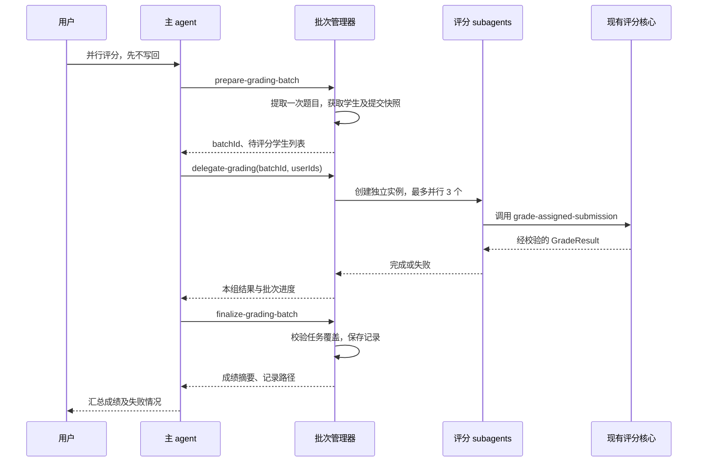

# 并行评分 Subagent 实现文档

状态：第一版已实现并通过自动化测试；真实服务的3～5名学生本地试运行待进行。日期：2026-10-08。

本设计适用于当前 TypeScript Canvas Auto-Grader。保留现有 Responses API 客户端、GLM/视觉模型配置和评分规则，增加主 agent 按需委派评分 subagent 的能力。第一版不引入新的 agent 框架。

## 1. 实现目标与决策

用户可以在 `npm run agent` 中说：

```text
给课程 12345 作业 67890 评分，题目文件 ./作业1.md。
使用 subagent 并行处理，先保存成绩，不写回 Canvas。
```

主 agent 创建评分批次，按需要委派多个评分 subagent，获得结果后生成成绩汇总和本地记录。

第一版的具体决策：

- 使用“agent 作为工具”模式。委派工具等待这一组 subagent 完成后返回，不采用后台轮询。
- 预设 `grader` 角色；每个学生创建一个独立运行实例，不让模型自由生成角色或权限。
- 主 agent 决定是否委派，以及每轮委派哪些学生；程序控制并发上限、任务范围和结果完整性。
- subagent 有独立消息历史、提示词和工具循环。第一版仅提供一个限定当前学生的评分工具。
- 评分工具调用现有 `gradeSubmission()`；其经过校验的 `GradeResult` 是成绩来源。
- subagent 的自然语言总结不作为分数来源。主 agent 不重新计算或修改工具返回的成绩。
- 子 agent 不写回 Canvas。成绩记录汇总后沿用现有 `post-grades` 工具写回。
- 第一版新增独立的委派流程，保留现有 `grade-all`。CLI `grade` 后续已接入同一主 agent 工具循环，默认走并行批次路径，保留默认写回、`--dry-run` 和满分评语选项。

## 2. 与现有代码的关系

| 当前文件 | 现有职责 | 本次变化 |
| --- | --- | --- |
| `src/agent/llm.ts` | 主 agent 提示词、工具声明、Responses 输入输出转换 | 允许传入运行配置与工具列表，不再只能使用全局工具集 |
| `src/agent/repl.ts` | 终端交互和最多 10 轮的工具循环 | 复用新 runtime，创建并传递会话服务，保留附件和命令行为 |
| `src/agent/types.ts` | Tool、ToolResult、ChatMessage、SessionContext | 增加运行上下文和配置类型，保留现有工具的兼容性 |
| `src/agent/registry.ts` | 主 agent 工具注册 | 注册批次准备、委派和汇总工具 |
| `src/agent/tools/grading.ts` | 单人、批量评分和写回 | 保留；新工具复用对应的附件、选择和写回辅助逻辑 |
| `src/grader/grader.ts` | 题目提取、评分校验、加分和迟交扣分 | 第一版无需改变评分算法 |
| `src/api/llm.ts` | 模型请求、视觉路由、错误处理 | 支持 AbortSignal、请求超时及可识别的 HTTP 错误 |

新增文件：

```text
src/agent/
  runtime.ts                 # 可复用的 agent 工具循环
  subagents/
    types.ts                 # 批次、任务、状态、结果
    manager.ts               # 会话内批次管理、队列、任务去重
    grader.ts                # grader 实例和限定评分工具
    prompts.ts               # grader 提示词
  tools/
    delegation.ts            # prepare/delegate/finalize 三个主 agent 工具
tests/
  agent-runtime.test.ts
  subagents.test.ts
```

依赖方向：`repl → runtime / manager`；`manager → grader → runtime / grader核心`。`runtime` 和 `llm.ts` 不导入主工具注册表，防止循环依赖。主工具注册表只在终端入口或主 agent 配置层装配。

## 3. 执行流程



`delegate-grading` 返回之前，程序完成这组任务；主 agent 不需要查询循环。主 agent 可以分多轮委派，但无需逐个等待学生评分。

## 4. 数据模型

以下类型为拟新增接口；未显示的导入和辅助实现需要开发时补全。

```ts
type TaskStatus = "pending" | "running" | "succeeded" | "failed";
type BatchStatus = "prepared" | "running" | "completed" | "partial" | "failed";

interface GradingTask {
  taskId: string;
  userId: number;
  status: TaskStatus;
  attempts: number;
  startedAt?: string;
  finishedAt?: string;
  error?: { code: string; message: string; retryable: boolean };
  result?: GradeResult;
}

interface GradingBatch {
  batchId: string;
  courseId: number;
  assignmentId: number;
  assignmentFile: string;
  rubric: AssignmentRubric;
  status: BatchStatus;
  createdAt: string;
  // 在准备时冻结的学生、提交及截止时间，不在任务中重新匹配顺序。
  submissions: ReadonlyMap<number, Submission>;
  studentNames: ReadonlyMap<number, string>;
  dueAt?: string | null;
  tasks: Map<number, GradingTask>;
  skipped: { userId: number; reason: string }[];
  recordFile?: string;
  manifestFile?: string;
}
```

- `batchId` 和 `taskId` 使用 `crypto.randomUUID()`。
- 一批中每个待评分学生仅有一个任务；重试复用任务 ID 并增加 `attempts`。
- 内部批次持有题目和提交快照，工具返回时仅输出可序列化的摘要。
- 不把附件图片 Base64、API Key 或全部学生解答放进主 agent 的消息历史。
- 批次存储在当前会话服务实例中，不用模块级全局 Map。任务和结果由管理器保存，禁止靠模型生成的 ID 或分数创建记录。

## 5. 主 agent 的三个工具

所有参数都需要运行时 Zod 校验。当前 Tool.parameters 是给模型看的 JSON Schema，不替代 handler 校验。

### 5.1 prepare-grading-batch

参数：

```ts
{
  courseId: number;         // 正整数
  assignmentId: number;     // 正整数
  assignmentFile: string;   // 非空本地路径
  userIds?: number[];       // 可选范围；不传表示所有符合条件的学生
}
```

handler 的顺序：

1. 使用 `loadAssignment(assignmentFile)` 读取题目并生成一次 rubric。
2. 获取提交和学生列表；校验显式 userIds 是否属于本作业提交范围。
3. 仅选取 `submitted` 或 `graded` 提交，沿用 `shouldSkipSubmission()` 的环境设置。
4. 按现有逻辑补取缺失的作业截止时间；对待评分学生调用 `getLatePenalty()` 验证时长是否可计算，但此处不扣分。
5. 创建批次和 pending 任务，记录跳过原因。尚不下载学生附件。

返回示例：

```json
{
  "batchId": "<uuid>",
  "courseId": 12345,
  "assignmentId": 67890,
  "rubricItemCount": 8,
  "maxScore": 80,
  "eligibleStudents": [{ "userId": 101, "name": "学生甲" }],
  "skipped": [],
  "concurrencyLimit": 3
}
```

显式学生 ID 无效、题目提取失败或关键截止信息无效时，返回错误，不创建可执行批次。

### 5.2 delegate-grading

参数：

```ts
{
  batchId: string;
  userIds: number[];      // 1～50 个唯一正整数
  retryFailed?: boolean; // 默认 false；只能重试被标记为可重试的失败
}
```

不允许模型传入任意提示词、工具名称、模型、题目内容或分数。分配给 grader 的任务描述由服务端模板生成。

执行规则：

- 在启动任何任务前，校验全部 userIds，避免一半启动后才发现参数错误。
- ID 不属于批次：整次调用失败。
- 已成功任务：返回已保存结果，不再调用模型。
- 已运行任务：复用正在执行的 Promise，不重复启动。
- 已失败任务：默认返回失败；只有 `retryFailed=true` 且错误可重试、未超总次数时才重新运行。
- 创建多个 grader 实例，放入共享并发队列。队列属于会话 manager，所有批次共同受限。
- 等待所有选中任务结束，分别保存成功和失败，不因一项失败丢弃其余结果。

返回每人的 `taskId`、`userId`、状态、分数/满分或错误，以及批次 pending/running/succeeded/failed 数量。详细逐项结果留在管理器，汇总时写入文件。

建议使用固定数量 worker 消费队列；不要直接对所有学生无上限 `Promise.all()`。单个 slot 覆盖子 agent 模型循环、附件处理和评分模型请求，保证不会同时下载和转换大量 PDF。

### 5.3 finalize-grading-batch

参数：`{ batchId: string }`。

校验与保存：

1. 尚有 pending 或 running 任务时返回错误，并给出未完成 ID；不把任务遗漏当成完成。
2. 全部任务结束后，逐个校验成功结果的题目 ID、得分和迟交数据。
3. 有失败则状态为 `partial`，全部失败则为 `failed`，全部成功则为 `completed`。
4. 即使存在失败，也保存成功记录和清晰的失败清单，便于重新评分。
5. 无符合条件学生时保存空记录，返回 completed 和全部跳过原因。

记录文件兼容现有 `post-grades`：

```text
output/grading_records_<assignmentId>_<batchId>.json
  内容：(GradeResult & { userId: number })[]，仅包含成功任务

output/grading_batch_<assignmentId>_<batchId>.json
  内容：批次元信息、逐任务状态、attempts、失败、跳过、记录路径
```

使用同目录临时文件写入后 rename，避免写出半份 JSON。汇总与重试通过批次锁串行化；无状态变化时重复 finalize 返回相同路径，有重试完成时重新生成同一批次的快照。

本工具不写回 Canvas。主 agent 后续使用现有 `post-grades`，明确区分“完整批次”与“部分成功记录”。不要把 partial 摘要表述成所有学生已评分成功。

## 6. grader 子 agent 的实现

每个实例的固定配置：

```ts
{
  name: `grader-${task.userId}`,
  instructions: GRADER_SYSTEM_PROMPT,
  tools: [gradeAssignedSubmission],
  maxTurns: 4,
}
```

提示词要求：

```text
你是处理单个学生提交的评分子 agent。
调用 grade-assigned-submission 获取当前任务的正式评分结果。
该工具已经绑定学生、作业和题目清单；不要请求更换任务范围。
评分标准由程序提供：每项完整得 10 分，否则 0 分，不判断答案对错。
最终只能总结工具返回的成绩和原因；工具失败时报告失败，不能猜测分数。
```

`grade-assigned-submission` 不接受模型参数，使用 handler 闭包绑定的批次和 task：

1. 从提交快照读取当前学生附件。
2. 调用 `prepareAttachments()`，完整保留已有格式、大小和 PDF 页数校验。
3. 调用 `gradeSubmission(content, batch.rubric, timing)`。
4. 校验返回结果，交给 manager 保存，并返回工具摘要。

评分核心调用已经根据附件内容选择视觉或文本模型。子 agent 外层对话只处理任务描述及工具摘要，因此无需把图片发送给外层对话模型。

评分工具成功后，runtime 直接结束该子 agent 运行，以工具结果标记成功，不再额外调用模型生成最终总结。这是第一版刻意采用的“成功工具即完成”策略，避免模型总结失败影响有效成绩。主 agent 负责面向用户的最终说明。

如果模型没有调用评分工具、调用未知工具或耗尽 maxTurns，任务失败。评分工具执行失败时立即结束该运行，由 manager 判定是否重试。相同任务内重复调用评分工具复用同一个 Promise。

此角色具备独立模型与工具循环，但工作范围很窄。如果只需要加速固定评分，直接并发 `gradeSubmission()` 更省一次路由调用；本方案额外保留子 agent 抽象，方便以后增加证据读取或复核工具。

## 7. runtime 重构接口

拟新增接口：

```ts
interface AgentRunConfig {
  name: string;
  instructions: string;
  tools: Tool[];
  maxTurns: number;
  stopAfterTools?: string[];
}

interface AgentRunResult {
  status: "completed" | "failed" | "max_turns";
  messages: ChatMessage[];
  finalText?: string;
  error?: { code: string; message: string };
}

async function runAgentLoop(
  messages: ChatMessage[],
  config: AgentRunConfig,
  context: AgentExecutionContext,
): Promise<AgentRunResult>;
```

实现要点：

- `chat()` 接收显式 instructions 和 tools，继续保留 Responses `response_output`、call_id、多模态转换及当前错误处理。
- 工具解析、查找和执行从 `repl.ts` 移到 runtime；按本次 config.tools 查找，不能回退到全局 registry。
- Tool.handler 可增加可选第二个 context 参数。现有单参数 handler 保持可用。
- 主 agent 保持最多 10 轮；grader 最多 4 轮。终端打印、`/attach`、`/clear`、readline 留在 repl。
- 默认顺序执行工具。并发仅在 `delegate-grading` 内部开启，避免误并行写回或执行有依赖的工具。
- 工具结果必须匹配原 call_id；isError 不能作为成功结果处理。
- `stopAfterTools` 仅在工具成功后触发。若同一响应有多个工具调用，须给每个 call_id 生成结果再结束，不留下缺失输出。
- 输入 JSON 无效或参数不符时返回明确工具错误，不像当前实现一样解析失败后静默使用 `{}`。
- 达到最大轮数返回显式状态，不冒充完成。

会话上下文区分两类：主 agent 可带课程/作业默认值及 batch manager；子 agent 只带绑定任务、取消信号和日志接口，不注入主对话的默认课程或作业。

`/clear` 清空聊天和附件，并在没有在途任务时释放会话内批次。已保存文件保留；清空后可通过记录路径写回，不能继续使用旧 batchId。

## 8. 成绩校验与一致性

成绩记录必须由程序验证，不能信任模型总结：

- userId 来自提交快照，不从模型文本解析。
- 每个 rubric ID 恰好出现一次，无未知 ID。
- `complete` 对应 10 分，其余允许状态对应 0 分；`unreadable` 沿用现有报错规则。
- 每项 maxScore 为 10，总 maxScore 为 rubric 项数 × 10。
- baseScore 为逐项得分之和。
- lateSeconds/latePenalty 与冻结的 timing 按 `getLatePenalty()` 重算一致。
- score 为 `Math.max(0, baseScore - latePenalty)`。
- 所有数字有限，关键字段经过 schema 校验。

迟交扣分在 `gradeSubmission()` 中执行一次。汇总只检查结果，不再次扣分。

批次准备时冻结 Canvas 提交元信息；第一版不保证准备后学生重新上传附件时的版本隔离。再次评分应新建批次。不要将不同批次的记录自动合并。

## 9. 并发、超时与重试

新增 `.env.example` 配置：

```dotenv
SUBAGENT_MAX_CONCURRENCY=3
SUBAGENT_TASK_TIMEOUT_MS=300000
SUBAGENT_MAX_ATTEMPTS=2
LLM_REQUEST_TIMEOUT_MS=120000
```

启动时严格校验：并发数为 1～8 的整数；任务/请求超时为正整数；尝试次数为 1～3 的整数。超时和尝试次数均为程序策略，不让模型自行提高。

- 队列等待不计入 task timeout；开始运行时启动计时。
- 任务超时通过 AbortController 传播到外层 chat、内层评分请求和附件处理。
- `src/api/llm.ts` 将 signal 传给 fetch，并区分 `timeout`、`cancelled`、网络错误、HTTP 状态和模型输出错误。
- 附件下载需传入 signal；PDF 子进程需要在取消时终止并清理临时文件，先检查现有 helper 的实现再补齐。
- 不用单独 `Promise.race()` 冒充取消：底层仍在运行会占用资源并可能迟到写入结果。
- 超时后直到相关执行清理结束才释放 slot；超过任务代次的迟到结果不得修改新尝试的状态。
- 网络连接错误、429、5xx 可自动重试，最多 2 次总尝试；遵守 Retry-After，缺失时使用短指数退避及抖动。
- 401/403、题目或附件问题、关键内容不可辨认、结果 schema/题号错误不自动重试。
- 自动重试与主 agent 显式重试共用 attempts 上限，不叠加两套无限重试。
- 不自动重试 Canvas 写回；它不在子 agent 的执行范围内。

第一版批次在内存中执行，进程退出后不恢复在途任务。持久恢复、后台运行和跨会话任务查询属于后续功能。

## 10. 主 agent 的提示词与对话行为

更新 `AGENT_SYSTEM_PROMPT`：

- 保留原有 `grade-submission` / `grade-all` 能力，添加并行 subagent 评分路径。
- 用户指定 subagent 或希望并行处理时，使用 prepare → delegate → finalize。
- 用户未要求特定方式时，允许 agent 按任务规模选择；单人普通评分可继续使用 grade-submission。
- 批次准备后，使用工具返回的学生 ID 分配，不编造 ID。
- 对所有待评分学生完成委派，再汇总；不能遗漏剩余任务。
- 工具错误说明失败原因；部分成功必须展示成功/失败数量。
- 用户要求先不写回时，只保存记录并报告路径；后续明确请求写回时调用 post-grades。

delegate 单次最多 50 个学生；超过该数量时分轮委派。大量学生摘要应保持紧凑，完整明细保留在文件，避免主 agent 10 轮上限和上下文容量成为隐性限制。若一批无法在轮数限制内完成，返回明确的未完成批次信息，不能声称整批完成；大批量自动调度可后续由一个程序工作流工具接管。

## 11. 日志与可观察性

统一使用 batchId、taskId、userId 关联日志：

```text
[batch <id>] prepared: eligible=6 skipped=1 concurrency=3
[task <id>] user=101 running attempt=1
[task <id>] user=101 succeeded score=70 maxScore=80 elapsedMs=15200
[task <id>] user=102 failed code=ATTACHMENT_UNREADABLE
[batch <id>] finalized: succeeded=5 failed=1 records=output/...
```

至少记录状态变化、开始/结束时间、尝试次数和错误代码。错误文本需要去除鉴权信息。第一版不要求 token 统计，因为当前 LLM 客户端没有暴露 usage；后续可以扩展。

## 12. 开发顺序

1. 提取 runtime，并让现有主 agent 使用它；保留现有工具、附件、Responses 历史及最大轮数行为。
2. 补齐模型请求和附件处理的超时/取消接口，建立错误分类。
3. 实现 batch manager、受限并发队列和限定当前学生的 grader。
4. 实现并注册三个工具，补充参数校验和主 agent 提示词。
5. 实现汇总文件、manifest、原子保存、兼容现有 post-grades 的成绩记录。
6. 增加有针对性的测试，更新 README、COMMANDS 和 .env.example。

不要在本轮顺带修改每题 10 分的评分规则、满分评语规则或 CLI 的默认写回行为。

## 13. 测试与验收

自动化测试使用 mock 模型、mock Canvas 和临时附件，不访问真实服务或写回真实成绩。

| 场景 | 预期 |
| --- | --- |
| 多个学生，受控延迟 | 实测存在重叠执行，峰值不超过配置上限；包含跨批次情况 |
| 子 agent 独立运行 | 工具定义仅含限定评分工具，消息中无其他学生解答或主历史 |
| 一个失败、其余成功 | 保留成功结果；失败无成绩，finalize 返回 partial |
| 重复委派成功/在途任务 | 不增加模型调用，不产生重复成绩 |
| 未授权学生 ID | 全部启动前报错，不执行任何任务 |
| 子 agent 未调用工具、工具失败、超轮数 | 显式 failed，不采信模型直接报出的分数 |
| 题号缺失、重复、不可辨认 | 沿用评分核心拒绝结果，不保存为成功 |
| 迟交学生 | 最终分数仅扣一次迟交分 |
| 429/5xx 与 401 | 前者受限重试，后者立即失败 |
| 任务超时 | fetch 被取消，PDF 进程终止，slot 在清理后释放，无迟到写入 |
| 未完成即 finalize | 返回未完成 ID，不生成完整成功记录 |
| 结果文件写回兼容 | 现有 post-grades 正确匹配 userId，并保留满分评语/跳过设置 |
| 多模态主 agent 与旧评分路径 | 现有 Responses、附件、评分及写回测试保持通过 |

执行 `npm run typecheck` 和 `npm test`。额外人工试运行 3～5 名学生，先只保存本地成绩，确认分数、失败清单与附件处理行为。真实 Canvas 写回不属于实现测试。

验收时应能看到三个独立 taskId 的重叠运行、完整学生覆盖、可校验的逐项记录，以及主 agent 使用工具结果生成的汇总。

## 14. 后续扩展与参考

后续按实际需要增加：

- reviewer 角色：仅对有分歧或需要复核的题目审查，并明确裁决规则。
- 按题目拆分同一学生：先返回逐项评估，合并完整题目清单后统一计算总分及迟交扣分，不能累加多个完整 GradeResult。
- 异步任务工具：start/check/update/cancel，以及持久化与恢复。
- 框架适配：将 grader 和主 agent 的配置迁移到 SDK，继续保留成绩校验和 Canvas 写回层。

可借鉴的官方机制：

- [OpenAI Agents SDK：agent.asTool()](https://developers.openai.com/api/docs/guides/agents/orchestration)：主 agent 保持最终回答控制权，专门 agent 作为工具调用。
- [LangChain Deep Agents：Subagents](https://docs.langchain.com/oss/javascript/deepagents/subagents)：独立上下文、角色配置与并行委派。
- [LangChain Deep Agents：Async subagents](https://docs.langchain.com/oss/javascript/deepagents/async-subagents)：长期任务的生命周期工具，适合作为后续扩展参考。
- [Claude Agent SDK：Subagents](https://code.claude.com/docs/en/agent-sdk/subagents)：独立运行、限定工具和结果返回。
- [OpenAI Responses：原生 Multi-agent](https://developers.openai.com/api/docs/guides/responses-multi-agent)：服务端编排方案；为 beta 且有模型支持要求，不能假定当前 GLM 服务兼容。

上述框架机制是参考，本文件的工具名、配置项和运行接口均是本项目的拟新增设计，不是已经存在的 SDK API。
